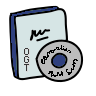

<h1 align="center">
  <a href="https://github.com/oot4/viper-sourcing-ceragine">
    
  </a>
</h1>

<div align="center">
  Ceragine - An Entity-Component-System approach to developing games
  <br />
  <br />
</div>

<div align="center">
<br />

</div>

<details open="open">
<summary>Table of Contents</summary>

- [About](#about)
    - [Built With](#built-with)
- [Getting Started](#getting-started)
    - [Prerequisites](#prerequisites)
    - [Usage](#usage)
        - [Ceragine](#ceragine)
- [Roadmap](#roadmap)

</details>

---

## About

<table>
<tr>
<td>

Ceragine is a Java library and framework built from the prototype Triumph 2D engine which explored the integration of an entity-component-system architecture. It is intended to be the successor of Triumph 2D. Ceragine can also be considered an interactive-based 2D rendering application engine, built to make gameplay development more efficient in time
consumption, well-structured to reduce the expense of maintenance, easy to understand and use and to also introduce a novel approach to developing games at least in 2D environments.

Entity-component-systems aim create a structured relation between functionality and data. By using component types to store different formats of data, systems are then constructed to operate on specific compositions of components. These systems need not know where the data comes from and usually do not require information about the owner of the data to
perform their functionality. By combining different systems to manipulate the data within components, complex behaviours can be constructed. What is also unique is that, systems are pluggable and can be activated and deactivated as needed.

This is still a new concept that is still seeing improvements and revisions.

Key features of **Ceragine**:

- Easy spritesheet management
- Robust state machine system
- Pluggable systems to do a desired task
- Preset systems for rendering, animation, special effects, etc.
- Easy settings configurations
- Loggable output to a file or to console and a debug mode
- Resource management library for flexibility
- Simplified access to other unmentioned features
- Quick, simple and maintainable workflow

<details open>
<summary>Additional info</summary>
<br>

Ceragine is the result of a dissertation project which initially tried to explore the use of behavioural artificial intelligence in games with multiple agents. The focus however, shifted due to some hurdles encountered during the development of that project where it was apparent that a novel approach to gameplay was required.

Ceragine is also the successor of a previous prototype called Triumph 2D. Triumph 2D pioneered the research in to the use of an entity-component-system architecture and provide an experimenting ground for testing the limits of the new concept

</details>

</td>
</tr>
</table>

### Built With

- [Java](https://www.java.com/download/ie_manual.jsp)
- [Maven](https://maven.apache.org/)

## Getting Started

### Prerequisites

The recommended method to install **Ceragine** is to use Maven to build and include Ceragine as a dependency after downloading the Ceragine source files. This will work as long as Maven and Java are installed.

Visit the maven homepage and get the latest release or install Maven through your chosen IDE

```shell
mvn clean install
```

### Usage

#### Ceragine

After installing the ceragine build locally with the command above, specify the dependency in your maven project

```xml

<dependencies>
    <dependency>
        <groupId>viper.sourcing</groupId>
        <artifactId>viper-sourcing-ceragine</artifactId>
        <version>1.0.0</version>
    </dependency>
</dependencies>
```

Reload your maven project and the library should now be usable. This can be tested by using the debugging tool provided in Ceragine

```java

import game_debugger.Alert;
import game_debugger.GameDebugger;

public class TestProgram
{

    public static void main( String[] args )
    {
        GameDebugger.log( Alert.INFO , "Hello World" );
    }

}
```

### Roadmap

See the [open issues](https://viper-sourcing.atlassian.net/jira/software/projects/VSC/boards/4/roadmap) for a list of proposed features (and known issues).